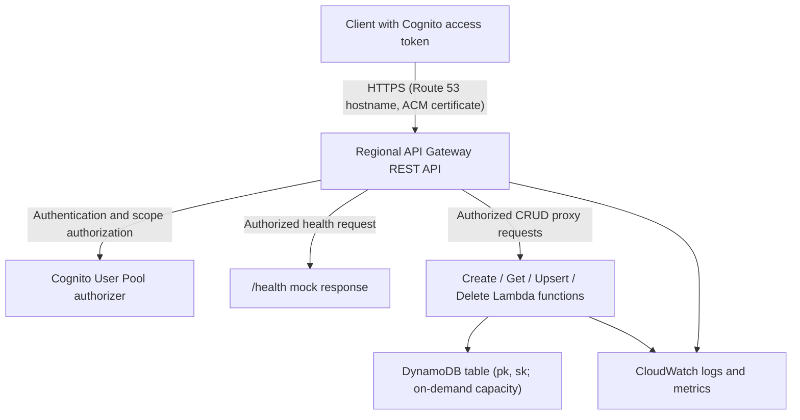

# Architecture

## Infrastructure

### Logical architecture

The service separates the API boundary, business logic, and persistence:

- The API contract defines collection operations, input/output shapes, and
  required authentication scopes.
- Authentication and scope authorization guard the API boundary. Any item-level
  ownership or tenant checks belong in the application logic.
- Each CRUD operation delegates to its own function, using shared models and
  key helpers to keep data handling consistent.
- Persistence stores the collection's items using namespaced composite keys.
- Logs and metrics expose request and function behavior for operations.

The health endpoint checks the API boundary through a mock response; it does
not check business logic or persistence.

### Physical architecture



`template.yaml` owns the DynamoDB table, four Lambda functions and their
API Gateway invoke permissions, API, certificate, and DNS configuration.
The Cognito pool, hosted zone, SSM hosted-zone parameter, and CI roles are
external dependencies.

Each Lambda has a `DynamoDBCrudPolicy` scoped to this table. API routes are
wired through `openapi.yaml`, not through SAM function `Events`. All functions
receive the table name through `DDB_TABLE_NAME`.

The API stage is named by `CodeBranch`. Its access log group is
`/aws/api-gateway/<stack-name>` with seven-day retention. Detailed logging and
metrics are described in [Observability](observability.md).

### CloudFormation template

`template.yaml` is the infrastructure-as-code entry point. Its
`Transform: AWS::Serverless-2016-10-31` enables AWS SAM resources, which
CloudFormation expands into the AWS resources needed to deploy the service.

| Section | Purpose |
| --- | --- |
| `Parameters` | Supplies domain/system/component metadata, branch stage name, hostname, hosted-zone SSM parameter, and existing Cognito pool ARN. |
| `Globals.Function` | Sets defaults for the Python runtime, timeout, memory, table environment variable, and Powertools service name. |
| `Resources` | Declares the table, functions, invoke permissions, API, certificate, API access log group, and API Gateway IAM role. SAM also generates supporting resources such as function execution roles. |

The API's `DefinitionBody` includes `openapi.yaml` through `AWS::Include`.
That file defines routes, Cognito authorization, and Lambda integration ARNs;
the function resources define each handler's code location and permissions.
`Ref` and `GetAtt` connect resources without hard-coding generated names or ARNs.

`cfn-parameters.json` and `cfn-tags.json` provide deployment-action inputs,
while `samconfig.toml` supplies SAM deployment defaults. See
[Configuration](configuration.md) for their expression syntax and external
prerequisites. Validate changes with `sam validate --lint` and package function
code with `sam build` before deployment.

## Software

### Python

The selected Python version is used by Lambda and recorded in `Pipfile` for
local development. Handlers use the installable `common` package for shared
models and utilities, and Powertools for logging and API Gateway event wrapping.

#### Pipenv

##### Virtualenv management

Pipenv isolates this project's runtime and development dependencies from system
Python and other projects. Install the selected Python version and Pipenv,
then run `pipenv install --dev` from the generated repository root to create
the virtual environment and install the `Pipfile` dependencies.
The local `common` package is installed in editable mode, and `Pipfile.lock`
records resolved dependency versions for repeatable installs.

##### Executing tasks using the virtualenv

Use `pipenv run <command>` to execute a command inside the project environment
without activating it manually, or `pipenv shell` for an interactive shell.
The `Pipfile` defines named tasks: `pipenv run test-unit` runs unit tests;
`pipenv run test` targets all tests; and `pipenv run pylint` and
`pipenv run mypy` run the configured check scripts.
Pipenv manages the development environment, not deployment ZIP contents;
SAM packages runtime dependencies from each function's `requirements.txt`.

#### Pytest for tests

Pytest discovers tests under `tests/`, as configured by `pytest.ini`.
The starter unit tests use fixtures for input data and Lambda context,
Moto for AWS mocking, and `pytest-mock` for deterministic handler dependencies.
The Pipfile test scripts use `pytest-cov` to report coverage across `src` and
require at least 95% coverage.

Run a focused test with `pipenv run pytest -vv <test-file>` from the generated
repository root, then run `pipenv run test-unit` for the unit suite and coverage
check. Integration and end-to-end directories are placeholders, so these tests
do not verify the deployed API or its infrastructure. See
[Common tasks](common-tasks.md#tests) for adding and validating tests.

### Anatomy of a function

For example, `src/handlers/Create${{ values.collection_name_cap }}Item/` contains
the following files:

| File | Purpose |
| --- | --- |
| `function.py` | Defines the Lambda entry point `handler`, business logic in `_main`, response dataclasses, logging, and AWS client setup. SAM's `Handler: function.handler` selects this module and callable. |
| `requirements.txt` | Declares the runtime dependencies SAM packages with this function, including the local common package and Powertools. Keep function-specific dependencies here rather than adding them to every handler. |
| `__init__.py` | Marks the directory as a Python package for imports, including imports from unit tests. It is empty in the starter and is not the Lambda entry point. |

Each function has its own directory and a SAM `CodeUri` pointing to it so SAM
can build and deploy a **separate ZIP artifact for each function**, containing
that function's code and runtime dependencies rather than all handlers and their
combined dependencies. Tests and mock data live outside these directories and
are not part of the function artifacts.

This layout keeps artifacts smaller per function and prevents a large dependency
needed by one function from increasing every other function's package size and
cold-start overhead. Dependencies placed in the shared common package are still
included in each function that depends on it, so keep large function-specific
dependencies out of that package. Separate artifacts avoid unnecessary shared
startup costs; actual cold-start performance also depends on imports, module
initialization, and Lambda configuration.

1. Module initialization creates a Powertools logger, a DynamoDB resource in
   `us-east-1`, and the table reference from the environment.
2. `@LOGGER.inject_lambda_context` enriches logs with invocation context.
3. `@event_source(data_class=APIGatewayProxyEvent)` wraps the incoming API Gateway
   event for access to its body and path parameters.
4. `handler` parses request data into shared dataclasses and delegates database
   work to `_main`.
5. The handler constructs a response-body dataclass and JSON-encodes it into an
   `Output` with `statusCode` and string `body`.
6. `@lambda_dataclass_response` converts the outer dataclass into a dictionary
   suitable for Lambda proxy output. It does not perform schema validation.

Shared model code is in `src/common/common/model/${{ values.collection_name }}.py`.
`Base${{ values.collection_name_cap }}Data` is the place for business fields;
`${{ values.collection_name_cap }}Data` adds the optional API `id`;
`${{ values.collection_name_cap }}ItemKeys` holds `pk` and `sk`; and
`${{ values.collection_name_cap }}Item` combines keys and data for storage.
Its `get_data()` excludes storage keys from the returned data.

Create uses a conditional `put_item` to avoid overwriting an existing key.
Upsert uses a conditional `put_item` requiring an existing key: it replaces
the stored item rather than partially updating attributes.

### Anatomy of a test

`tests/unit/handlers/Create${{ values.collection_name_cap }}Item/test_function.py`
illustrates the starter pattern:

- Constants locate the function's fixtures under `./data/handlers/<function>/`.
- Pytest fixtures read JSON into event/data/output/response objects.
- `tests/conftest.py` provides a mock Lambda context factory.
- Moto's `mock_aws()` isolates AWS calls; a fixture creates a table with the
  same string `pk` and `sk` key schema.
- `pytest-mock` patches the handler's `DDB_TABLE` and generated keys to make
  assertions deterministic.
- Handler tests assert status and decoded response; `_main` tests assert
  database state and conditional-write behavior.

These tests do not exercise deployed API Gateway, Cognito, DNS, or IAM.
`tests/integration/` and `tests/ete/` are placeholders, not a supplied live test suite.
See [Common tasks](common-tasks.md) for validation commands and schema-test guidance.

### Anatomy of mock data and schemas

Each `data/handlers/<function>/` directory pairs JSON examples with schemas:

| Files | Meaning |
| --- | --- |
| `event.json`, `event.schema.json` | API Gateway invocation envelope, including paths and request context. |
| `data.json`, `data.schema.json` | Business input used by test fixtures; tests insert its JSON into the event body where needed. |
| `response.json`, `response.schema.json` | Decoded API response body. |
| `output.json`, `output.schema.json` | Lambda proxy result, including status code and JSON-encoded body string. |

`data/common/` holds reusable API Gateway event and Lambda output schemas,
plus collection data and DynamoDB-item examples/schemas.
Some per-function schemas reference these through `file:./data/common/...`.
Run fixture-based tools from the repository root so relative paths resolve.
Schema examples do not automatically enforce validation in production handlers.

### DynamoDB single-table design

The table's composite primary key has string **partition key `pk`** and string
**sort key `sk`**. Generic names allow multiple entity types in one table.
The starter uses equal key values for each item:

```text
pk = ${{ values.collection_name }}#<uuid>
sk = ${{ values.collection_name }}#<uuid>
id = <uuid>
```

`create_keys()` generates these namespaced keys;
`get_keys_from_id(id)` reconstructs them for reads, updates, and deletes;
`get_id_from_keys(keys)` extracts the ID by splitting `pk` on `#`.
The API exposes the unprefixed ID, not the storage key.

For more entity types or relationships, design namespaces and access patterns
together, for example `customer#123` and `order#456`. Update all three helpers,
models, and tests consistently; the current extraction logic assumes a simple
`namespace#id` format. Changing key formats requires a migration plan for existing
items. No secondary indexes or relationship-query patterns are supplied.

### Repository file layout

```text
catalog-info.yaml       Backstage Component and API entities
mkdocs.yml              TechDocs site configuration
docs/                   Handbook pages
README.md               Project entry point
template.yaml           SAM infrastructure
openapi.yaml            API contract and Gateway integrations
cfn-parameters.json     Deployment-action parameter expressions
cfn-tags.json           Deployment-action tag expressions
samconfig.toml          SAM deploy defaults
Pipfile                 Local runtime/dev dependencies and scripts
pytest.ini              Pytest configuration
.cfnlintrc              CloudFormation lint configuration
.github/workflows/      main.yml and branch.yml
src/common/             Installable common package, setup.py, Makefile
src/common/common/      Shared model and utility modules
src/handlers/           Per-function code and requirements.txt
data/common/            Shared examples and schemas
data/handlers/          Per-function examples and schemas
tests/conftest.py       Shared test fixtures and import setup
tests/unit/handlers/    Per-function unit tests
tests/integration/      Integration-test placeholders
tests/ete/              End-to-end-test placeholders
```

These are generated-project paths. The template source repository keeps their
inputs separately under `skeleton/base/`, `skeleton/crud/`, `functions/crud/`,
and `pipeline/` before the scaffolder combines them.
